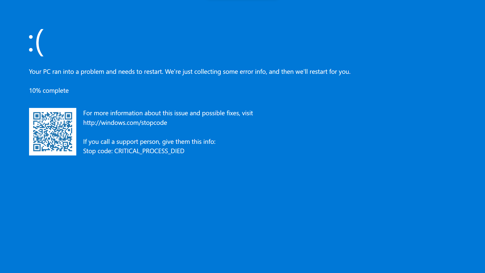

# BSOD



## Overview

`bsod` is a lighthearted python package that simulates a windows-style Blue Screen of Death (BSOD). When executed, it takes over the screen, blocks keyboard input, and displays a fullscreen BSOD image accompanied by audio.

This project is intentionally simple and experimental in nature. It is meant for **educational, demonstrational, and humorous purposes only**, particularly to explore system-level interactions from Python and understand how desktop applications can manipulate user input and display behavior.

## Key Features

* Fullscreen BSOD-style visual using `pygame`
* Optional delayed execution via a timer
* Keyboard input blocking
* Audio playback during the BSOD screen
* Packaged as a command-line tool (`bsod`)
* Includes bundled assets (image and audio) via Python packaging

> **Important:** This package interacts directly with keyboard input and window focus. It should not be run on production systems or machines with unsaved work.

---

## Installation

You can directly run using 
```bash
uvx bsod
```

or install the package directly from PyPI:
```bash
pip install bsod
```

### Platform Notes

* Designed primarily for **Windows**
* Uses Windows-specific libraries (`pywin32`, `keyboard`)
* May not function correctly on Linux or macOS

---

## Usage

After installation from PyPI, the package exposes a console command:

```bash
bsod
```

Running this command will immediately:

1. Block keyboard input
2. Launch a fullscreen BSOD window
3. Play an audio file
4. Keep running until forcefully terminated

### Using a Timer

You can delay the BSOD screen using the `-t` or `--timer` flag:

```bash
bsod -t 20
```

This will wait **20 seconds** before triggering the BSOD behavior.

* Time is specified in **seconds**
* During the delay, nothing is blocked until the timer completes

---

## Command-Line Arguments

| Argument        | Description                                      |
| --------------- | ------------------------------------------------ |
| `-t`, `--timer` | Delay execution by a specified number of seconds |

If no arguments are provided, the BSOD is triggered immediately.

---

## How It Works (High-Level)

* The entry point is defined via `console_scripts` in `setup.py`
* `bsod.main` parses CLI arguments and manages execution timing
* Keyboard input is blocked using the `keyboard` library
* The BSOD screen is rendered in fullscreen using `pygame`
* Assets (image and audio) are bundled and resolved using `pkg_resources`
* Threads are used to block input and display the screen concurrently

---

## Project Structure

```
arpy8-bsod/
├── README.md
├── LICENSE
├── MANIFEST.in
├── setup.py
├── bsod/
│   ├── __init__.py
│   ├── main.py
│   ├── utils.py
│   └── assets/
│       ├── image.png
│       └── audio.mp3
└── .github/
    └── workflows/
        └── python-publish.yaml
```

### Notable Files

* `main.py` – CLI entry point and argument handling
* `utils.py` – Keyboard blocking, window handling, and display logic
* `MANIFEST.in` – Ensures asset files are included in the package
* `.github/workflows/python-publish.yaml` – GitHub Actions workflow for PyPI publishing

---

## Dependencies

The package relies on the following libraries:

* `pygame`
* `keyboard`
* `pyautogui`
* `pywin32`
* `setuptools`

These are automatically installed when installing the package via pip.

---

## Safety & Disclaimer

This package:

* Blocks keyboard input
* Forces fullscreen display
* Requires manual termination in some cases

**Use at your own risk.**
The author is not responsible for any unintended consequences, system disruptions, or data loss resulting from its use.

This project is intended strictly for:

* Educational demonstrations
* Experimentation
* Humor

---

## License

This project is licensed under the **MIT License**.

You are free to:

* Use
* Modify
* Distribute
* Share

See the `LICENSE` file for full details.

---

## Author

**Arpit Sengar**
GitHub: [https://github.com/arpy8](https://github.com/arpy8)

Contributions, issues, and suggestions are welcome.
